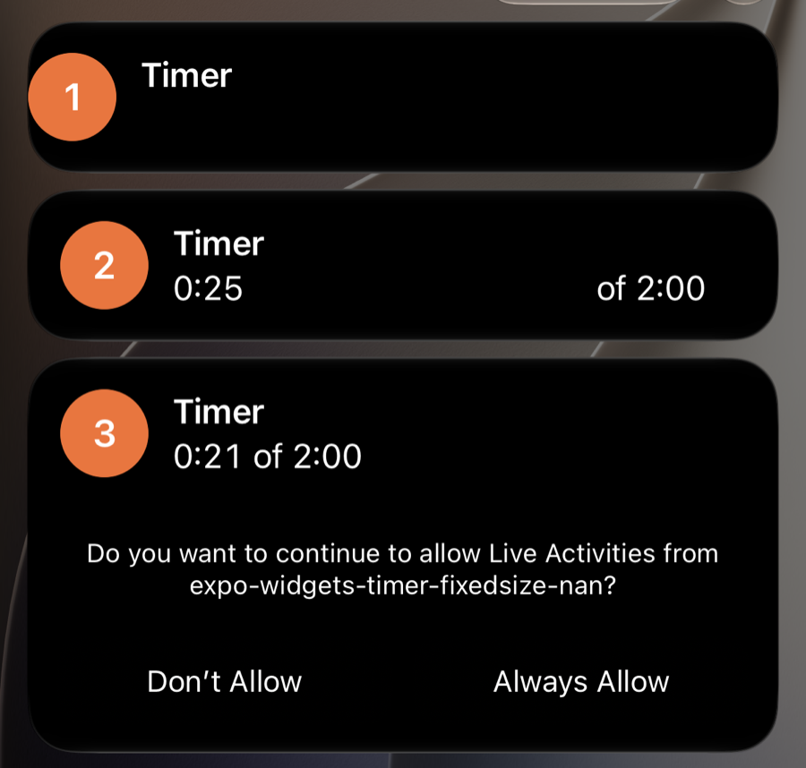

# expo-widgets: `Text(timerInterval:)` + `fixedSize` breaks the Live Activity banner on iOS 27

Minimal reproduction for an expo-widgets Live Activity whose Lock Screen banner loses its timer and layout on iOS 27.

A `Text` with `timerInterval` and `fixedSize({ horizontal: true })` has no finite width. When iOS 27 lays out the archived Live Activity, the timer's width becomes NaN. In this repro the timer row disappears and the banner loses its padding. In a production banner with more nesting (icon, stacks, a button) the whole card was empty.

## Run

```sh
npm install
npx expo run:ios   # iOS 27 simulator or device
```

In the app:

1. Tap the three **Start** buttons. On the first start, allow Live Activities.
2. Press Home and swipe down from the top edge to open Notification Center (the simulator's lock button does nothing), or lock the device.

The three banners are identical except for the timer ([`TimerActivity.tsx`](TimerActivity.tsx)):

| # | Timer | Result on iOS 27 |
| --- | --- | --- |
| 1 | `fixedSize({ horizontal: true })` | Timer row ("0:21 of 2:00") missing, padding lost |
| 2 | No `fixedSize` | Renders, but the timer fills the row and pushes "of 2:00" to the far edge |
| 3 | Hidden `0:00` placeholder + `Overlay` with the timer, then `fixedSize` | Renders as intended |



## Renderer log

Stream the renderer log while starting an activity:

```sh
xcrun simctl spawn booted log stream --level debug --style compact \
  --predicate 'process CONTAINS "WidgetRenderer"' | grep -A6 "Rendering view"
```

Each activity's archived display list is printed. With the timer's `fixedSize`, the banner's frames come out NaN. A production banner's root frame read:

```
(item #:identity 728 #:views true
  (frame (nan 0.0; nan 72.0))
    (frame (nan 14.0; 44.0 44.0))
```

The same banner with a fixed `frame({ width })` on the timer instead of `fixedSize`:

```
(frame (0.0 0.0; 374.0 72.0))
  (frame (16.0 14.0; 44.0 44.0))
```
